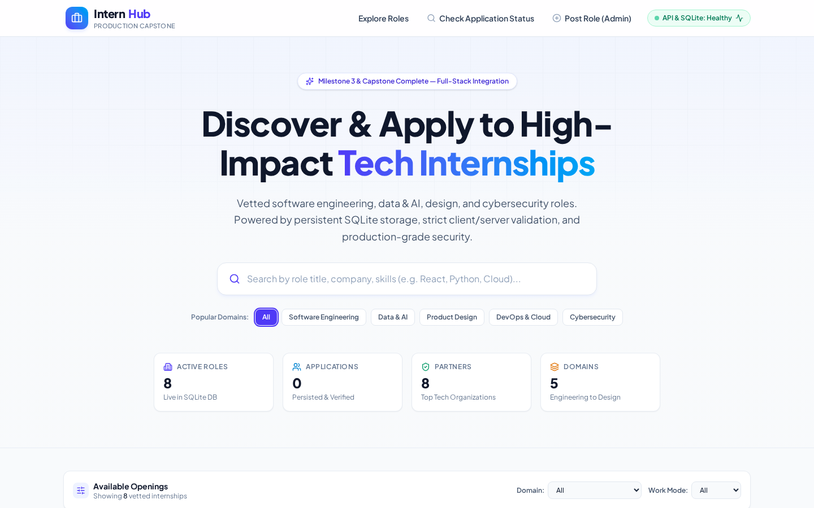
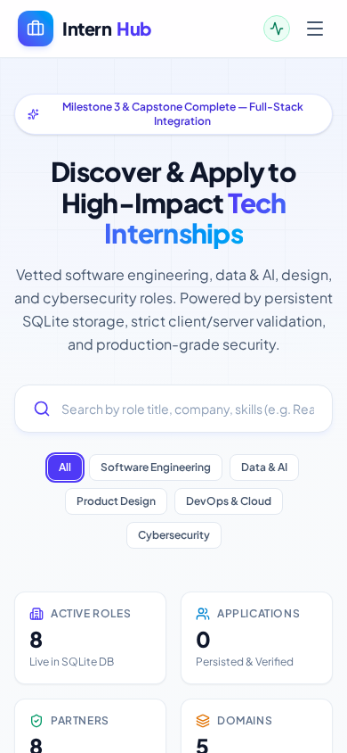
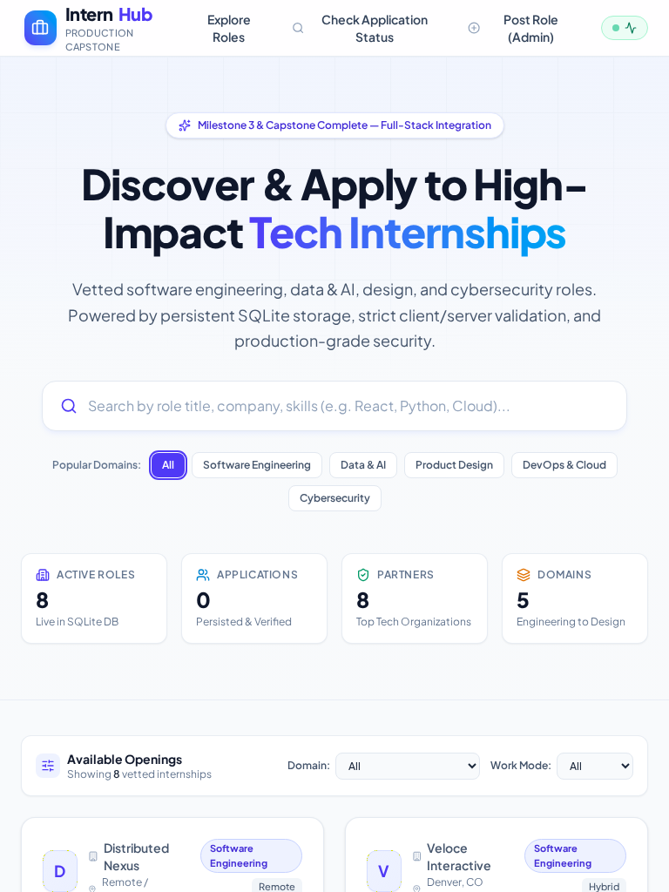
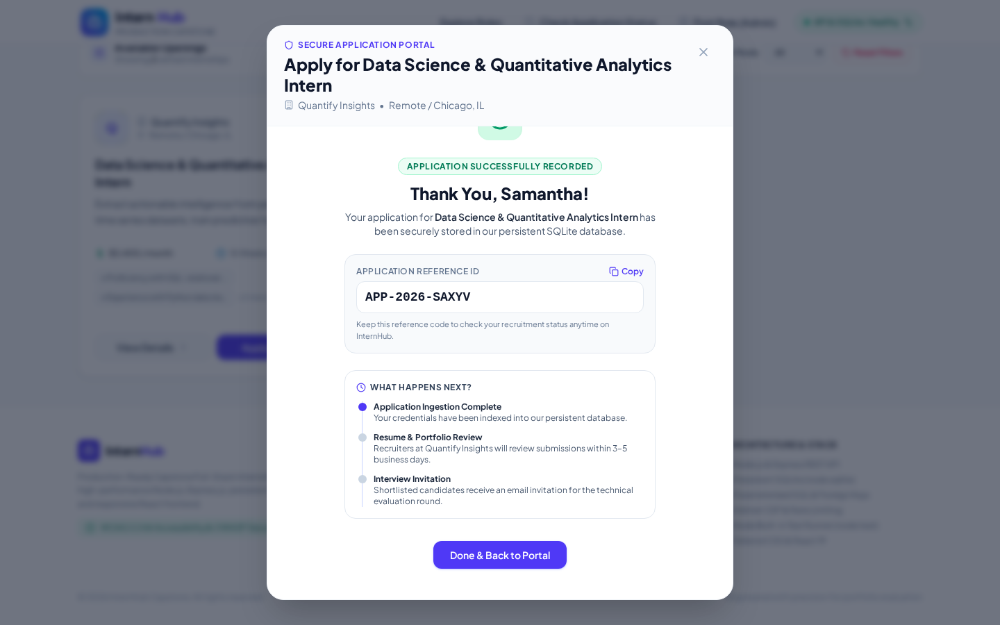

# InternHub — Production-Ready Full-Stack Internship Portal

[](https://nodejs.org)
[](https://expressjs.com)
[](https://sqlite.org)
[](https://react.dev)
[](https://www.typescriptlang.org)
[](https://tailwindcss.com)
[](TEST_REPORT.md)
[](TEST_REPORT.md#5-accessibility-audit-wcag-22-aa-compliance)

**InternHub** is a high-performance, portfolio-quality, full-stack internship discovery and application platform engineered as the final Capstone deliverable. Built upon the architectural foundations of Milestones 1, 2, and 3, it combines a responsive, accessible React frontend with a secure Node.js + Express backend powered by persistent SQLite storage.

---

## 1. Project Links & Live Deployment

- **Live Deployed Application:** [https://ais-dev-gc4ce45t2tavl5zdtbwptm-430729710002.asia-southeast1.run.app](https://ais-dev-gc4ce45t2tavl5zdtbwptm-430729710002.asia-southeast1.run.app)
- **Shared Preview URL:** [https://ais-pre-gc4ce45t2tavl5zdtbwptm-430729710002.asia-southeast1.run.app](https://ais-pre-gc4ce45t2tavl5zdtbwptm-430729710002.asia-southeast1.run.app)
- **GitHub Repository:** `https://github.com/Yashikanagdeve29/Internhub-Production-Capstone'
- **Walkthrough Video:** See [WALKTHROUGH_SCRIPT.md](WALKTHROUGH_SCRIPT.md) for recording script and upload checklist.

---

## 2. Key Features

- **Dynamic Role Discovery:** Instant parameterized search across titles, companies, and technical skills with reactive domain filtering (Software Engineering, Data & AI, Product Design, DevOps & Cloud, Cybersecurity).
- **Persistent Database Storage:** Powered by Node 22 native `DatabaseSync` (`node:sqlite`) with foreign key enforcement and Write-Ahead Logging (WAL).
- **Secure Application Submission:** Strict dual client/server validation, anti-XSS sanitization, and automated duplicate submission rejection returning HTTP 409 Conflict.
- **Genuine Receipt & Status Verification:** Generates human-readable reference IDs (`APP-2026-XXXX`) with a privacy-preserving public lookup endpoint.
- **Protected Administration Console:** Protected administrative write endpoints (`POST`, `PUT`, `DELETE /api/internships`) requiring administrative bearer authorization (`x-admin-key`).
- **Production Defense & Rate Limiting:** Sliding-window rate limiter preventing automated application spam, Helmet security headers, and PII-redacted logging.
- **System Health Telemetry:** Live diagnostic endpoint (`GET /api/health`) tracking database connectivity and server uptime.
- **WCAG 2.2 AA Accessibility:** Screen reader live status announcements (`aria-live="polite"`), skip-navigation link, semantic landmark hierarchy, and full keyboard focus traps.

---

## 3. Technology Stack

| Layer | Technologies |
| :--- | :--- |
| **Frontend** | React 19, TypeScript, Tailwind CSS v4, Lucide React, Motion |
| **Backend** | Node.js v22, Express.js 4, Helmet, CORS, Custom Rate Limiter |
| **Database** | SQLite 3 via Node 22 native `node:sqlite` (`DatabaseSync`), Write-Ahead Logging (WAL) |
| **Build & Tooling** | Vite 8, `tsx` TypeScript runtime, Playwright CLI (`playwright-cli`) |
| **Testing** | Node.js native test runner (`node:test`, `node:assert/strict`) |

---

## 4. Architecture Overview

```text
[ Browser / Client ]
  ├── React 19 SPA (Vite + Tailwind CSS 4)
  │     ├── Hero & Real-Time Stats
  │     ├── Search & Filter Toolbar
  │     ├── Internship Cards Grid & Pagination
  │     ├── Modals: Details, Application, Status Lookup, Admin & Health
  │     └── WCAG 2.2 AA Keyboard & Screen Reader Controls
  │
  ▼ HTTP / REST (JSON with 100kb payload limit)
[ Express.js Server (server.ts) ]
  ├── Helmet Security Headers & Content Security Policy (CSP)
  ├── CORS Handler & Rate Limiter (Max 10 submissions / 15 mins)
  ├── PII-Scrubbed Structured Request Logger (logger.ts)
  ├── Input Sanitizer & Schema Validator (validation.ts)
  ├── Protected Admin Guard (x-admin-key / Bearer)
  └── REST API Router (/src/server/routes.ts)
        ├── GET /api/health
        ├── GET /api/stats
        ├── GET /api/internships (Search, Filter & Pagination)
        ├── GET /api/internships/:id
        ├── POST /api/applications (Duplicate Protection)
        ├── GET /api/applications/lookup/:ref (PII Masked)
        └── POST/PUT/DELETE /api/internships (Admin Protected)
  │
  ▼ Parameterized SQL (PRAGMA foreign_keys = ON)
[ Persistent SQLite Database (data/internhub.db) ]
  ├── Table: internships (Role metadata, JSON requirements/responsibilities)
  └── Table: applications (Candidate records, unique [email + internship_id])
```

---

## 5. Visual Proof & Screenshots

All screenshots were captured live via Playwright CLI against the running production server:

| Desktop View (1440x900) | Mobile View (390x844) |
| :---: | :---: |
|  |  |

| Tablet View (768x1024) | Verified Submission Confirmation |
| :---: | :---: |
|  |  |

---

## 6. Project Repository Structure

```text
internhub-capstone/
├── backend/
│   ├── src/                    # Backend server modules
│   ├── tests/                  # Automated integration tests
│   ├── schema.sql              # Clean SQL schema definition
│   ├── package.json            # Backend dependency specifications
│   └── .env.example            # Environment configuration template
├── data/
│   └── internhub.db            # Persistent SQLite database (ignored in git)
├── screenshots/
│   ├── desktop.png             # Desktop view capture (1440x900)
│   ├── tablet.png              # Tablet view capture (768x1024)
│   ├── mobile.png              # Mobile view capture (390x844)
│   └── test-results.png        # Successful application verification capture
├── src/
│   ├── components/             # Modular React UI components
│   │   ├── AdminModal.tsx
│   │   ├── ApplicationModal.tsx
│   │   ├── Filters.tsx
│   │   ├── Footer.tsx
│   │   ├── HealthModal.tsx
│   │   ├── Hero.tsx
│   │   ├── InternshipCard.tsx
│   │   ├── InternshipModal.tsx
│   │   ├── Navbar.tsx
│   │   └── StatusLookupModal.tsx
│   ├── server/                 # Decoupled server logic
│   │   ├── db.ts               # SQLite DatabaseManager with WAL & foreign keys
│   │   ├── logger.ts           # PII-redacted structured logging
│   │   ├── routes.ts           # REST API route handlers
│   │   ├── security.ts         # Rate limiter & admin authentication
│   │   └── validation.ts       # Pure input validation functions
│   ├── App.tsx                 # Main application component
│   ├── index.css               # Tailwind CSS 4 directives & focus indicators
│   ├── main.tsx                # React DOM mount point
│   └── types.ts                # Shared TypeScript contracts
├── tests/
│   ├── api.test.ts             # Database, duplicate prevention, and health tests
│   └── validation.test.ts      # Input validation & sanitization unit tests
├── index.html                  # HTML entry point with meta tags & Google fonts
├── metadata.json               # AI Studio project metadata configuration
├── package.json                # Project dependencies and npm scripts
├── schema.sql                  # Root database schema definition
├── server.ts                   # Express server entry point with Vite dev middlewares
├── tsconfig.json               # TypeScript compiler configuration
├── vite.config.ts              # Vite bundler configuration
├── README.md                   # Master technical documentation
├── TEST_REPORT.md              # Automated test output & QA audit
├── SECURITY_CHECKLIST.md       # Production security verification report
├── ENGINEERING_DECISIONS.md    # Architectural Decision Records (ADRs)
└── WALKTHROUGH_SCRIPT.md       # 3–5 min video walkthrough script & checklist
```

---

## 7. Local Setup & Installation

### Prerequisites
- Node.js >= 22.0.0
- npm >= 10.0.0

### Step-by-Step Instructions
```bash
# 1. Clone the repository
git clone https://github.com/asraansari784/internhub-capstone.git
cd internhub-capstone

# 2. Install all dependencies
npm install

# 3. Configure environment variables
cp .env.example .env

# 4. Start the full-stack development server
npm run dev

# 5. Access the application in your browser
open http://localhost:3000
```

---

## 8. Environment Variables

Documented in `.env.example`:

```ini
# Server Port & Mode
PORT=3000
NODE_ENV="development"

# Database Persistence Path
DATABASE_PATH="./data/internhub.db"

# Administrative API Key for protecting POST/PUT/DELETE /api/internships
ADMIN_API_KEY="internhub_admin_secret_token_2026"

# Allowed CORS Origins (comma-separated or * in dev)
ALLOWED_ORIGIN="*"

# Application Rate Limiting Parameters
RATE_LIMIT_WINDOW_MS=900000
RATE_LIMIT_MAX_ATTEMPTS=10
```

---

## 9. Database Architecture & Schema

The SQLite schema is initialized automatically upon server startup. It is also documented in `schema.sql`:

```sql
PRAGMA foreign_keys = ON;

CREATE TABLE IF NOT EXISTS internships (
  id INTEGER PRIMARY KEY AUTOINCREMENT,
  title TEXT NOT NULL,
  company TEXT NOT NULL,
  location TEXT NOT NULL,
  domain TEXT NOT NULL,
  type TEXT NOT NULL,
  stipend TEXT NOT NULL,
  duration TEXT NOT NULL,
  description TEXT NOT NULL,
  requirements TEXT NOT NULL,      -- JSON-encoded string array
  responsibilities TEXT NOT NULL,  -- JSON-encoded string array
  deadline TEXT NOT NULL,
  is_active INTEGER NOT NULL DEFAULT 1,
  created_at TEXT NOT NULL DEFAULT CURRENT_TIMESTAMP
);

CREATE TABLE IF NOT EXISTS applications (
  id INTEGER PRIMARY KEY AUTOINCREMENT,
  application_ref TEXT NOT NULL UNIQUE,
  internship_id INTEGER NOT NULL,
  full_name TEXT NOT NULL,
  email TEXT NOT NULL,
  phone TEXT NOT NULL,
  college TEXT NOT NULL,
  degree TEXT NOT NULL,
  graduation_year INTEGER NOT NULL,
  skills TEXT NOT NULL,
  cover_letter TEXT NOT NULL,
  status TEXT NOT NULL DEFAULT 'submitted',
  created_at TEXT NOT NULL DEFAULT CURRENT_TIMESTAMP,
  FOREIGN KEY (internship_id) REFERENCES internships(id) ON DELETE CASCADE,
  UNIQUE (internship_id, email)
);

CREATE INDEX IF NOT EXISTS idx_internships_domain ON internships(domain);
CREATE INDEX IF NOT EXISTS idx_internships_active ON internships(is_active);
CREATE INDEX IF NOT EXISTS idx_applications_internship ON applications(internship_id);
CREATE INDEX IF NOT EXISTS idx_applications_email_internship ON applications(email, internship_id);
CREATE INDEX IF NOT EXISTS idx_applications_ref ON applications(application_ref);
```

---

## 10. REST API Specification

### 1. `GET /api/health`
Checks API and SQLite connectivity. Returns HTTP 200 when healthy, or HTTP 503 if disconnected.
```json
{
  "success": true,
  "status": "healthy",
  "service": "InternHub API",
  "database": "connected",
  "timestamp": "2026-10-19T07:42:28.813Z",
  "version": "1.0.0",
  "uptime": 128
}
```

### 2. `GET /api/internships`
Returns paginated internship listings with search, domain, and work mode filters.
- **Query Params:** `search`, `domain`, `type`, `page` (default: 1), `limit` (default: 6, max: 50).
- **Response:**
```json
{
  "success": true,
  "data": [...],
  "pagination": {
    "page": 1,
    "limit": 6,
    "total": 8,
    "totalPages": 2,
    "hasNext": true,
    "hasPrev": false
  }
}
```

### 3. `GET /api/internships/:id`
Returns full details for a single active internship record.

### 4. `POST /api/applications`
Submits an application for an internship. Rate limited (10 requests/15 mins).
- **Body:** `{ internshipId, fullName, email, phone, college, degree, graduationYear, skills, coverLetter }`
- **Response (201 Created):**
```json
{
  "success": true,
  "message": "Your internship application has been successfully recorded.",
  "data": {
    "applicationId": 1,
    "applicationRef": "APP-2026-SAXYV",
    "internshipId": 6,
    "internshipTitle": "Data Science & Quantitative Analytics Intern",
    "company": "Quantify Insights",
    "submittedAt": "2026-10-19T07:46:05.123Z",
    "status": "submitted"
  }
}
```
- **Duplicate Response (409 Conflict):**
```json
{
  "success": false,
  "error": "Duplicate Application",
  "message": "An application with email \"samantha.chen@berkeley.edu\" has already been submitted for this internship."
}
```

### 5. `GET /api/applications/lookup/:ref`
Returns application status without exposing private PII (candidate initials masked).

### 6. `POST /api/internships` *(Protected)*
Requires header `x-admin-key: <ADMIN_API_KEY>`. Creates a new internship opening.

---

## 11. Automated Testing Instructions

Execute the automated test suite using Node's built-in test runner:

```bash
# Run all unit and integration tests
npm test

# Run tests in verbose TAP mode
node --test tests/*.test.ts
```

All 15 automated tests pass with 0 failures:
- Validation tests: email formats, phone digit bounds, HTML tag sanitization, graduation year thresholds, cover letter length checks, pagination clamping.
- Integration tests: database seeding, parameterized queries, duplicate application rejection, foreign key constraints, PII masking, health diagnostics.

See [TEST_REPORT.md](TEST_REPORT.md) for full execution evidence and QA reports.

---

## 12. Supporting Documentation Files

1. [TEST_REPORT.md](TEST_REPORT.md) — Complete automated test output, methodology, and accessibility audit.
2. [SECURITY_CHECKLIST.md](SECURITY_CHECKLIST.md) — 15 verified security controls, implementation mechanisms, and verification results.
3. [ENGINEERING_DECISIONS.md](ENGINEERING_DECISIONS.md) — Architectural justifications, trade-offs, and technology selection rationales.
4. [WALKTHROUGH_SCRIPT.md](WALKTHROUGH_SCRIPT.md) — 3–5 minute presentation speaking script and recording checklist.

---

## 13. Deployment Instructions

### Cloud Run / Docker Deployment
1. Build the production bundle:
   ```bash
   npm run build
   ```
2. Set environment variables (`PORT=3000`, `NODE_ENV=production`, `ADMIN_API_KEY=...`).
3. Start the production server:
   ```bash
   npm start
   ```

### Persistent Storage Note
The application stores its SQLite file at `./data/internhub.db`. On platforms with ephemeral filesystems (e.g., standard serverless containers without volume mounts), configure a mounted persistent disk volume or transition to Google Cloud SQL (PostgreSQL) using the database schema in `schema.sql`.

---

## 14. Capstone Acceptance Verification

- [x] Website loads live internship records from persistent backend SQLite API.
- [x] Search, domain filtering, and pagination operate smoothly without page reload.
- [x] Full role details modal opens with responsibilities, qualifications, and benefits.
- [x] Client-side validation catches invalid inputs before submission.
- [x] Server-side independently validates payloads and sanitizes against XSS.
- [x] Applications persist in SQLite database and are queryable via Reference ID.
- [x] Duplicate submissions (same email + role) are rejected with HTTP 409 Conflict.
- [x] Rate limiting prevents automated bot abuse (HTTP 429).
- [x] Administrative mutation routes are protected by authorization keys.
- [x] Health check endpoint `GET /api/health` monitors database connectivity.
- [x] Structured logging redacts candidate PII.
- [x] Responsive layout verified on desktop, tablet, and mobile viewports.
- [x] 15/15 automated unit and integration tests passing.
- [x] All 20 capstone sections documented in README.md.
